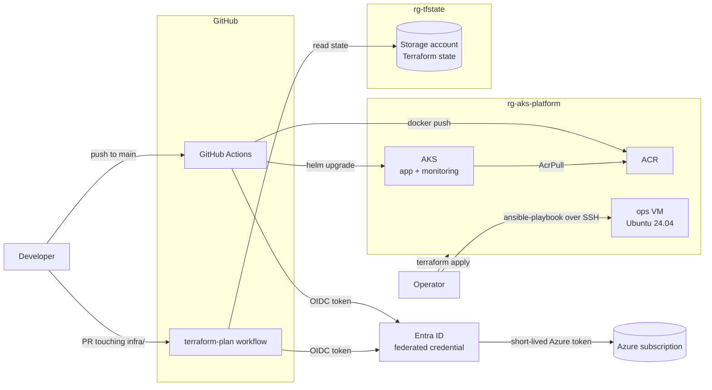

# azure-k8s-platform

An end-to-end platform on Azure, built entirely as code: Terraform provisions AKS, ACR and an ops VM; GitHub Actions builds and deploys a containerised API through **OIDC with no stored secrets**; Ansible configures the VM; and Prometheus/Grafana provide RED metrics and alerting.


## Architecture



| Layer | What it does | Where |
|---|---|---|
| **bootstrap** | Remote state storage and the CI identity (Entra app + federated credentials + least-privilege roles). Applied once, kept long-lived. | `bootstrap/` |
| **infra** | Resource group, ACR, AKS, ops VM, plus CI deploy permissions on ACR/AKS. Disposable: destroyed after each session to save cost. | `infra/` |
| **app** | FastAPI service with `/health`, `/metrics` and a version endpoint, packaged as a non-root container. | `app/` |
| **chart** | Helm chart: Deployment, Service, ServiceMonitor and PrometheusRule. | `charts/api/` |
| **CI/CD** | `deploy` on push to main, `terraform-plan` on pull requests. | `.github/workflows/` |
| **config mgmt** | Ansible playbook for the ops VM. | `ansible/` |
| **monitoring** | kube-prometheus-stack values. | `monitoring/` |

## Repository layout

```
.
├── bootstrap/              # state backend + GitHub OIDC identity (local state)
├── infra/                  # RG, ACR, AKS, ops VM (remote state in bootstrap storage)
├── app/                    # FastAPI service + Dockerfile
├── charts/api/             # Helm chart (Deployment, Service, ServiceMonitor, PrometheusRule)
├── ansible/                # playbook for the ops VM
├── monitoring/             # kube-prometheus-stack values
└── .github/workflows/      # deploy.yml, terraform-plan.yml
```

## Stage 1 – Terraform: state backend and platform

**bootstrap** creates `rg-tfstate` and a storage account (`Standard_LRS`, TLS 1.2, no public blob access, blob versioning on) with a private `tfstate` container. Its own state stays local because it creates the backend everyone else uses.

**infra** stores its state in that container (`platform.tfstate`) and creates:

- `rg-aks-platform`
- ACR (`Basic`, admin user disabled)
- AKS: one `standard_d2s_v7` node, system-assigned identity, explicit `upgrade_settings` to avoid drift
- `AcrPull` for the kubelet identity, so nodes pull images without credentials

The backend uses `use_azuread_auth = true`: state is accessed with Entra identities and RBAC, not storage account keys.

## Stage 2 – Application and Helm chart

The FastAPI app exposes:

| Endpoint | Purpose |
|---|---|
| `/` | Message, environment and the running `version` (the image tag, i.e. the commit SHA) |
| `/health` | Liveness and readiness probes |
| `/metrics` | Prometheus metrics |
| `/fail` | Returns 500 on purpose, to exercise error-rate queries and alerts |

Container and chart hardening:

- Runs as numeric UID `10001` (`USER 10001`), so kubelet can verify `runAsNonRoot`
- `seccompProfile: RuntimeDefault`, `allowPrivilegeEscalation: false`, all capabilities dropped
- Resource requests and a memory limit
- `required` on `image.repository` and `image.tag`, so an empty image reference fails at render time instead of deploying `:`

## Stage 3 – CI/CD with GitHub Actions and OIDC

No client secrets anywhere. `bootstrap/ci_identity.tf` creates an Entra application with two federated credentials. Their subjects use GitHub's immutable-ID format:

```
repo:<owner>@<owner_id>/<repo>@<repo_id>:ref:refs/heads/main   # deploy
repo:<owner>@<owner_id>/<repo>@<repo_id>:pull_request          # plan
```

Using IDs, not just names, means a deleted-and-recreated repository with the same name cannot assume this identity.

**Least privilege for the CI service principal:**

| Role | Scope | Defined in | Why |
|---|---|---|---|
| Reader | Subscription | bootstrap | Look up resources and run `terraform plan`; cannot change anything |
| Storage Blob Data Contributor | State storage account | bootstrap | Read state and take the state lock |
| AcrPush | ACR | infra | Push images |
| Azure Kubernetes Service Cluster User Role | AKS | infra | Fetch kubeconfig for Helm |

Deploy permissions live in `infra/`, so they are created and destroyed together with the resources they apply to.

### `deploy.yml` (push to `main` touching `app/`, `charts/` or the workflow)

1. OIDC login with `azure/login`
2. Find the ACR, and fail unless exactly one exists in the resource group
3. Build the image, tagged with the short commit SHA
4. **Smoke test** on the runner: `/health` responds, `/` reports the expected version, the container is not root
5. Push to ACR
6. `helm upgrade --install --atomic --wait`: a failed rollout rolls back automatically
7. Verify the version reported by the running pod matches the commit

`concurrency` serialises deployments, so two Helm operations never race on the same release.

### `terraform-plan.yml` (pull requests touching `infra/`)

`fmt -check` → `init` → `validate` → `plan`. Terraform authenticates itself through OIDC (`ARM_USE_OIDC`), so the job can read state and plan but, with only Reader on the subscription, cannot apply. Applying remains a deliberate, local step after review.

### Repository variables (not secrets)

| Variable | Source |
|---|---|
| `AZURE_CLIENT_ID` | `terraform -chdir=bootstrap output -raw client_id` |
| `AZURE_TENANT_ID` | `terraform -chdir=bootstrap output -raw tenant_id` |
| `AZURE_SUBSCRIPTION_ID` | `az account show --query id -o tsv` |
| `CI_PRINCIPAL_ID` | `terraform -chdir=bootstrap output -raw ci_principal_id` |
| `VM_SSH_PUBLIC_KEY` | Public key used for the ops VM |
| `ADMIN_SSH_CIDR` | Admin IP allowed to SSH, e.g. `1.2.3.4/32` |

None of these grant access on their own. Access requires a GitHub-issued token from this repository's `main` branch or a pull request.

## Stage 4 – Ops VM with Terraform and Ansible

Terraform creates the VM in its own VNet (`10.20.0.0/16`), isolated from AKS:

- NSG allows TCP 22 only from `admin_ssh_cidr`
- Ubuntu 24.04, `Standard_D2ls_v7`, NVMe disk controller
- SSH-key authentication only

Ansible then configures it:

- Installs Docker and base packages
- Creates a `deploy` user in the `docker` group with an authorised key
- Hardens sshd: `PermitRootLogin no`, `PasswordAuthentication no`
- Enables UFW with default deny incoming, allowing SSH only

That gives two layers of network control (cloud NSG plus host firewall) in front of key-only SSH. The playbook is idempotent: a second run reports `changed=0`.

## Stage 5 – Monitoring: Prometheus, Grafana and RED metrics

kube-prometheus-stack is installed with `monitoring/values.yaml`:

- Control-plane scrapers that AKS does not expose are disabled
- Alertmanager is disabled to fit a single node; rules still evaluate in Prometheus
- `serviceMonitorSelectorNilUsesHelmValues: false` and `ruleSelectorNilUsesHelmValues: false` make Prometheus pick up ServiceMonitors and rules from every namespace

The app records two metrics in a middleware: `http_requests_total{method,path,status}` and the histogram `http_request_duration_seconds`. The `path` label uses the route template rather than the raw URL, which keeps label cardinality bounded.

A **ServiceMonitor** selects the Service by label and scrapes each pod behind it through the named port `http`, so every replica is scraped, not just whichever pod the Service routes to.

**RED queries:**

```promql
# Rate: requests per second, excluding probes and scrapes
sum by (path) (rate(http_requests_total{path!~"/health|/metrics"}[1m]))

# Errors: share of 5xx responses
sum(rate(http_requests_total{status=~"5.."}[1m]))
  / sum(rate(http_requests_total{path!~"/health|/metrics"}[1m]))

# Duration: p95 latency
histogram_quantile(0.95,
  sum by (le) (rate(http_request_duration_seconds_bucket{path!~"/health|/metrics"}[1m])))
```

**Alert:** `ApiHighErrorRate` fires when the 5xx ratio stays above 5% for 5 minutes. It ships as a `PrometheusRule` inside the Helm chart, so alerting is versioned with the service.

## Reproduce

Prerequisites: Azure CLI, Terraform ≥ 1.6, kubectl, Helm, Docker, Ansible.

```bash
# 1. Bootstrap (once)
cd bootstrap
echo "subscription_id = \"$(az account show --query id -o tsv)\"" > terraform.tfvars
terraform init && terraform apply
# set github_owner_id / github_repo_id in ci_identity.tf for your repository
# then add the repository variables listed above

# 2. Infra: set storage_account_name in infra/versions.tf to the bootstrap output
cd ../infra
cat > terraform.tfvars <<EOF
subscription_id   = "$(az account show --query id -o tsv)"
ci_principal_id   = "$(terraform -chdir=../bootstrap output -raw ci_principal_id)"
vm_ssh_public_key = "$(cat ~/.ssh/azure_ops_vm.pub)"
admin_ssh_cidr    = "$(curl -s https://ifconfig.me)/32"
EOF
terraform init && terraform plan -out=tfplan && terraform apply tfplan
az aks get-credentials -g rg-aks-platform -n aks-platform

# 3. Monitoring: install BEFORE deploying the app, which ships ServiceMonitor/PrometheusRule CRs
helm repo add prometheus-community https://prometheus-community.github.io/helm-charts
helm upgrade --install monitoring prometheus-community/kube-prometheus-stack \
  -n monitoring --create-namespace -f ../monitoring/values.yaml \
  --set grafana.adminPassword="$(openssl rand -base64 18)" --wait

# 4. App: trigger the deploy workflow (Actions → deploy → Run workflow), or push to main

# 5. Ops VM
cd ..
printf "[ops]\nvm-ops ansible_host=%s ansible_user=azureuser ansible_ssh_private_key_file=~/.ssh/azure_ops_vm\n" \
  "$(terraform -chdir=infra output -raw vm_public_ip)" > ansible/inventory.ini
ansible-playbook -i ansible/inventory.ini ansible/playbook.yml
```

**Teardown** after each session: `terraform -chdir=infra destroy`. AKS and the VM are the only real costs. bootstrap stays, so CI keeps working after the next `apply`.

## Lessons learned

| Symptom | Root cause | Fix |
|---|---|---|
| `AADSTS700213: No matching federated identity record` | GitHub's OIDC `sub` now includes immutable owner/repo IDs | Build the subject from `owner@owner_id/repo@repo_id` in Terraform |
| `docker push`: `insufficient_scope` | An orphaned ACR from lost state; `az acr list [0]` picked the wrong registry | Removed the orphan; the workflow now requires exactly one ACR |
| Pod stuck in `CreateContainerConfigError` | `runAsNonRoot` with an image that ran as root | `USER 10001` (numeric) in the Dockerfile, `runAsUser` in the chart |
| Pods restarting, never Ready | Probes hit `/healthz`, the app serves `/health` | Aligned probe paths; added a smoke test before push |
| Helm: `another operation is in progress` | Overlapping deploys left the release `pending-upgrade` | `helm rollback`; `concurrency` and `--atomic` in the workflow |
| Helm reported success but nothing was deployed | Templates outside `templates/` are silently ignored | Moved files; run `helm template` before deploying |
| PR plan: empty SSH key or CIDR | `${{ vars.X }}` for an undefined variable evaluates to an empty string | Defined the repository variables; validate inputs |
| `VM size ... is not allowed` / B-series unavailable | Regional SKU restrictions on the subscription | Switched to allowed v7 sizes with an NVMe disk controller |
| `az login` blocked with `AADSTS530035` | Security defaults block device-code sign-in | Browser auth-code flow over an SSH port-forward |

## Known limitations and next steps

- **Single node, single region.** No zone redundancy; fine for a lab, not for production.
- **One CI identity for PRs and main.** A PR workflow could be edited to push or deploy with the same rights. Next step: separate identities, read-only state access for plans, and an approval-gated `environment` for apply.
- **No GitOps.** Deploys are push-based with Helm; Argo CD or Flux would add drift detection and pull-based reconciliation.
- **Cluster access.** AKS uses local accounts, so the kubeconfig carries an admin certificate, and the API server is public. Next step: Entra ID integration with Azure RBAC, `local_account_disabled`, authorised IP ranges or a private cluster.
- **No PR checks for `app/` and `charts/`.** Build, smoke test and `helm lint` only run after merge.
- **Alertmanager disabled.** Alerts are visible in Prometheus but not routed to Slack, email or on-call.
- **`docker` group ≈ root** on the ops VM; rootless Docker or narrower permissions would be safer.
- **Versions.** The kube-prometheus-stack chart version and GitHub Actions are not pinned to exact versions or SHAs.
- **bootstrap state is local.** It could be migrated into its own backend once created.
